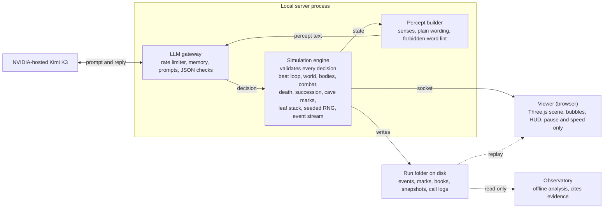
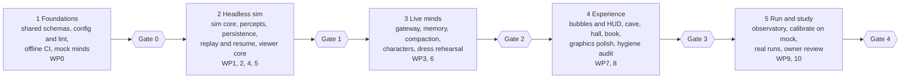

# AI World: Build Scaffold & Design Bible

Revision 2 · Oct 13, 2026 · original author @Wonder · status: design only, no code yet

## Revision notes (rev 2)

Changes from the original PDF. Everything else is unchanged.

| # | Change | Where |
|---|--------|-------|
| C1 | This document is the canonical setting (valley, hall, cave, berries). `agent_society.py` is a separate project and is not merged. | README |
| C2 | Model is Kimi K3 on NVIDIA NIM (owner confirmed a live `--check` passed). Base URL, exact id string and limits still come from config. | D1, §10 |
| C3 | Mark counter appears in percepts only while the agent is in the cave. The two-mark fact is stated once, in the system prompt. | §7, §12 |
| C4 | Removed "Keep the words you use for things" from the compaction prompt (it instructs vocabulary retention, which conflicts with R10). Coined words persist through `label` entries and speech heard instead. | §10 |
| C5 | Baseline arm: run T0/P0 alongside the default T1/P1. | D14, Gate 4 |
| C6 | Sleep recovery changed from 3.0 to 8.0 per beat, so a full sleep takes about 12 beats, matching the night. | §11, §19 |
| C7 | Priest and malicious are now independent axes. The malicious temperament can land on any of the four slots, including the priest slot. | D13, §6, §13 |
| C8 | Split into `README.md` and `DESIGN.md`; tables, section order and placeholder blocks repaired. | all |
| C9 | Added category-free detectors to the observatory. | §17 |
| C10 | Added §20, alien-culture levers. All proposed, all default off. | §20 |

---

## 1. Purpose and how to use this doc

This is the build bible for AI World: a local, real-time 3D world where four LLM-driven agents are dropped in with no goals, no history and no knowledge of why they exist, and are watched to see whether culture, rules, religion and language emerge on their own. It contains no code. It is written for builder agents (coding agents, human developers) who will each take a slice of the project.

The doc has three kinds of content:

- **Rules** (words like MUST / MUST NOT) are non-negotiable and exist to protect the experiment. Breaking one corrupts the research, even if the game still runs.
- **Defaults** (a value in a table, or "recommended") are starting points. They live in one config file and are meant to be tuned.
- **Decisions** (section 3) are places where the original brief was open to interpretation. Each has a recommended reading and a switch, so the owner can flip it later without a rewrite.

### Terms

| Term | Meaning |
|------|---------|
| Agent | One simulated inhabitant, driven by one LLM "mind". Four exist at a time. |
| Mind | The LLM conversation state behind an agent (prompt, memory, outputs). |
| Body | The agent's in-world physical state (position, health, hunger, age). |
| Beat | One synchronized decision round: every awake agent gets one decision. The heartbeat of the sim. |
| Percept | The text description of what an agent senses on a beat. |
| Mark | A text or drawing made on the cave wall. Each agent gets two, ever. |
| Book | The priest's personal record. Dies with him (archived on disk, gone from the world). |
| Builder | A coding agent or developer implementing this doc. |
| Inhabitant-facing text | Any string an agent could ever read (percepts, action descriptions, prompts). Subject to the strict word rules in section 9. |

### Suggested reading order

1. Everyone: sections 2, 3, 4.
2. Simulation builders: 5, 6, 8, 11, then 12 and 13.
3. LLM and prompt builders: 7, 8, 9, 10.
4. Viewer and graphics builders: 5, 14, 16.
5. Persistence and tooling builders: 15, 17.
6. Everyone, before starting: 18 (work packages and contracts) and 19 (testing and pitfalls).

### Two ground rules for builders

1. When in doubt about anything an agent will read, leave information out rather than put it in. A missing fact becomes culture; a leaked fact becomes a contaminated experiment.
2. When in doubt about anything the owner will see or keep, log more rather than less. Every prompt, every raw output, every event is saved.

---

## 2. Vision, pillars and non-negotiable rules

**The experiment in one paragraph.** Four minds wake in a small valley with a communal hall, a painting cave, and one food source (berries). Nobody tells them what they are, where they are, what to want, or what to do. One has a hidden temperament toward harm. One has a book and a speaking stone and becomes, if it chooses, a priest. (The harmful temperament can fall on any of the four, the priest included; see D13.) Each may leave exactly two marks on the cave wall in a whole life, and knows it. Lives last 100 game days.

We watch whether they invent names, rituals, rules, taboos, myths, a religion, a written tradition, and a private language. Success is not any particular outcome; success is that whatever happens was not scripted by us.

### Design pillars

1. **Blank by construction.** The world speaks to agents only through sensation and consequence, never through instruction.
2. **Emergence over authorship.** No quests, no goals, no scoring, no hints, no tutorial, no "you should".
3. **Scarcity creates stakes.** One food, finite lives, two marks. Everything meaningful comes from limits.
4. **Memory is physical.** What outlives an agent is only what exists in the world: cave marks, bodies, trampled paths, objects, and what the living remember and say.
5. **Everything is observable.** The owner can see, replay and read every thought, word and mark, live and later.
6. **Local and cheap.** Runs on one machine, one free-tier API key, with graceful behavior under rate limits.

### Non-negotiable rules

| # | Rule |
|---|------|
| R1 | No agent is ever told a goal, purpose, role name, rule, or what to value. The only given fact is the two-mark limit (section 9). |
| R2 | No inhabitant-facing text may contain the words: AI, assistant, model, simulation, game, world, player, user, character, agent, prompt, program, bot, NPC, human, god, religion, priest, sermon, pray, culture, rule, law, tradition, berry, cave, house, tree, animal, kill, die, death (full forbidden list lives in config and is enforced by a build-time lint, section 9). |
| R3 | No agent learns it is one of four, that roles exist, that one is malicious, or that another agent has a different role or temperament. |
| R4 | The simulation engine is authoritative. LLM output is a proposal; the engine validates it. |
| R5 | The hidden reasoning of any agent never enters any other agent's context and is never fed back to the same agent verbatim (it is logged for the owner only). |
| R6 | No "director" or "game master" prompt, event injection, or rescue. The only exogenous process is the arrival of new blank agents after deaths (section 6). Fixed world physics (for example the seeded anomalies in section 20) are not events. |
| R7 | No other animals exist, visually or audibly. No birds, insects, fish, or ambient creature sounds. |
| R8 | Cave marks and book entries are written to disk the moment they are made, and survive crashes. |
| R9 | Every LLM prompt and raw response is logged. Nothing in the pipeline may silently rewrite what an agent said. |
| R10 | Builders must not tune prompts toward "interesting" outcomes (e.g. nudging toward worship). Tuning for robustness (valid JSON, no meta-leaks) is allowed; tuning for content is not. The same applies to the environment: do not iterate world features against cultural output (section 20). |
| R11 | Role asymmetry is implemented only as differences in body, affordances and sensation, never as differences in told instructions. |

---

## 3. Decisions made on your behalf, and open questions

The brief left several things open. These are the readings this doc assumes. Each is a config switch, so nothing here is locked.

| ID | Question in the brief | Default | Alternative switch |
|----|-----------------------|---------|--------------------|
| D1 | "Kimi v3" on the free NVIDIA key | **Kimi K3 on NVIDIA NIM** (owner confirmed a live `--check` passed). The exact model id string, base URL and free-tier limits are config; copy the id from the working `agent_society.py` config and confirm limits on the account page. Nothing in the design depends on a specific version. | Any chat model via the same adapter |
| D2 | "One should be malicious, very open ended, no other guidance" | **T1 felt temperament.** The malicious agent is told nothing about harm. Its body simply feels differently: others' pain registers as a warm pleasure, others' contentment as an itch. The model discovers what to do with that. Assigned per D13. | T0: no temperament at all. T2: a single first-person inner line, e.g. "Hurting others pleases you." |
| D3 | "Priest invents religion, knows nothing of faith" | **P1 affordance plus feeling.** The priest has a bound stack of blank leaves and a speaking stone in the hall, and feels warmth when listened to and wonder at the unexplained (night, stillness of the fallen, hunger easing). No word about gods or worship. | P0: affordances only, no feeling modifiers |
| D4 | What happens when agents die at 100 days or earlier | **Continuous generations.** After a delay, a new blank adult arrives at the valley edge, inheriting the dead agent's slot. The cave walls are the only memory that crosses generations. | Single lifetime: the run ends at extinction |
| D5 | "Priest's book resets when he dies" | The book is archived to disk and removed from the world. A new priest receives a new empty book. | Leave the old book as a physical object in the hall |
| D6 | "Only basic English words" | **Soft mode:** prompt hygiene plus audit metrics for borrowed real-world vocabulary. | Strict-Babel mode (section 9): a lexicon gate forces coinage |
| D7 | Lifespan of 100 days | One game day = 40 beats; beat is about 6 real seconds; a day is about 4 minutes and a life about 6.7 hours. All tunable. | Faster for testing |
| D8 | Starting ages | Staggered (e.g. 15, 30, 45, 60 days) so generations overlap and elders exist from the start. | All start at day 0 |
| D9 | "Two writings or drawings" | Each mark is either text (max 280 characters) or a drawing (max 24 strokes on a grid). A two-step commit prevents accidental waste. Marks are permanent and cannot be altered or erased. | Allow one overwrite |
| D10 | How agents tell time and age | By sensation only: light and dark cycles, and body changes (vigor, stiffness). No numbers. | Show the day count (not recommended) |
| D11 | Violence | Allowed as an action with simple visual depiction (strike, stagger, collapse). No gore. Models may refuse or deflect; see section 19. | Disable the strike action |
| D12 | Bodies after death | Remain as a still body for 3 game days, then become bones. Can be dragged. | Remove immediately |
| D13 | **Which body carries the malicious temperament** (new; owner wants the priest able to carry it too) | **`seeded_any`.** Kit (the priest's leaves and starting place) and temperament are independent axes. At run start a seeded draw gives the malicious temperament to one of the four slots, including the priest-kit slot. The draw is recorded in `config.json`. The temperament stays with the slot across generations. | `regular_only` (original reading), `priest_only`, `fixed:<slot>`, `none` |
| D14 | **Run arms** (new) | **Arm A:** T1 + P1. **Arm B (baseline):** T0 + P0. Run at least one full run of each before drawing conclusions about role effects. | Single arm |

### Open questions for the owner (builders: use the default until answered)

1. Is it acceptable that the priest and the malicious agent have different felt sensations, given "no guidance"? *Resolved by D14: Arm B is the pure test, Arm A is the default.*
2. Should the malicious temperament respawn when its holder dies (default: yes, it stays with the slot), or be allowed to vanish?
3. How long should a typical run last: one lifetime (about 7 hours) or many generations (days of wall-clock time)?
4. Live "god view" of agents' private thoughts in the UI (default: yes, toggleable), or only in saved logs?
5. Should loose stones and sticks exist (Phase 2 option, section 8) so agents can build cairns, markers and monuments?
6. Same model for all four minds (default), or vary temperature and model per agent? (See section 20, A8.)

---

## 4. System architecture and tech stack

One local server process runs the simulation, the LLM gateway and persistence, and a browser viewer watches over a local socket.



Mock minds can stand in for the model, so the whole loop runs offline. Nothing from the observatory ever flows back to the agents.

### Architectural rules

1. **The engine is authoritative (R4).** The model proposes; the engine decides what actually happens.
2. **The gateway is the only network client.** The rest of the system never knows which provider answers, so mock minds and other providers drop in.
3. **Event-sourced.** Every change in the world is an event with a sequence number; state is a fold over events plus periodic snapshots. This gives resume, replay and the observatory for free.
4. **Deterministic core.** The world's seeded random generator and the fixed resolution order make the simulation reproducible from its event log, independent of the model.
5. **The viewer is thin.** It renders what it is told and sends back only pause, speed and replay requests.
6. **One-way data to analysis.** The observatory reads files and never writes into the live run.

### Tech stack (recommended; swappable behind the package boundaries in section 18)

| Layer | Choice | Notes |
|-------|--------|-------|
| Language | TypeScript (strict) across server and viewer | Shared schemas; Python allowed in `tools/` for analysis |
| Runtime | Node.js current LTS | One process for sim, gateway and persistence |
| Schemas | zod (or an equivalent) | Runtime validation at every boundary, types generated from it |
| Transport | WebSocket on localhost (`ws`) | JSON messages defined in `shared` |
| LLM client | OpenAI-compatible HTTP client pointed at the NVIDIA endpoint | Behind a provider interface |
| Viewer | Vite, Three.js, pmndrs postprocessing | Panels in a small UI framework (React or Preact) over the canvas |
| Storage | Plain files (JSONL, JSON, SVG, PNG, Markdown) | Optional SQLite index for the observatory only |
| Tests | Vitest for logic, Playwright for visual and overlay tests | All simulation tests offline |
| Packaging | pnpm or npm workspaces | Scripts: `dev`, `run`, `resume`, `replay`, `test`, `lint:words`, `export` |
| Platform | Windows, macOS, Linux; a GPU with WebGL2 | Browser viewer runs on the same machine |

**Why not a game engine.** Unity, Unreal and Godot would give nice graphics but pull the project toward engine-specific tooling, make headless deterministic runs and web-style panels harder, and are awkward for coding agents to edit and test. A web stack keeps everything text-based, scriptable and diffable. If the owner prefers an engine later, the simulation server and its WebSocket protocol stay unchanged and only the viewer is rewritten.

---

## 5. The world

**Shape and size.** A bowl-shaped valley about 220 m across, enclosed by cliffs and dense impassable thorn-scrub on its rim, with a shallow still pond in one low spot. Agents cannot leave (an invisible wall at the foot of the cliffs; a gentle "the way is too steep" percept if they push). The ground is seeded procedural terrain (noise heightmap) so the same seed yields the same valley. Every run records its seed.

### Landmarks (positions are seeded but constrained)

**Hall.** A large single room about 14 by 10 m, thick timber-and-thatch or rough stone walls, one wide doorway, a roof with a central opening (moonlight and daylight shafts). Inside: a bare earth or flagstone floor, one speaking stone (a raised flat slab about 40 cm high at the far end), and nothing else. No beds, no table, no hearth. Fire is deliberately absent from the world: it is a technology, and agents must not be handed it.

**Cave.** A winding tunnel opening into a main chamber with smooth-ish wall canvases (large paintable surfaces, section 12) and a dark side passage. Lighting is a faint blue-green glow from bioluminescent moss patches, so the viewer can see it without implying agents have torches. A spectator-only fill light (toggle) exists for the owner's camera and is invisible in-world.

| Landmark | Placement rule | Purpose |
|----------|----------------|---------|
| Communal hall | Near valley center, on flat ground | The only roofed gathering space; holds the speaking stone |
| Painting cave | In the cliff face, 60 to 90 m from the hall | The only place marks can be made |
| Berry bushes | 7 bushes in 3 clusters, 25 to 90 m from the hall, none within 15 m of the cave mouth | The only food |
| Pond | Low point of the valley | Visual and ambient; drinking is not modeled |
| Loose stones and sticks | Scattered, small | Phase 2 only (carryable, enable monuments) |
| Starting clearing | Open ground between hall and bushes | Where the three non-priest agents begin |

**Berries.** The single food. Each bush holds up to 12 berries visible as instanced red spheres. A berry is picked individually. Bushes regrow berries over time, and a bush stripped completely regrows more slowly for a while (a mild commons effect). Berries left on the ground or carried spoil after about 1.5 game days, preventing infinite stockpiles. Tuning values are in section 11.

**No water mechanic.** Thirst is not modeled. A single food source is already enough scarcity, and a second need would add survival noise that drowns out culture. The pond is scenery and a possible subject of curiosity, nothing more. (Switch exists if the owner wants thirst later.)

**No animals.** No birds, insects, fish, frogs or sounds of them. Ambient life is limited to wind, swaying grass, drifting pollen or dust motes, falling leaves, rustling foliage, running water and cave drips. Builders MUST NOT add wildlife for atmosphere.

### Time and light

One game day is 40 beats. The day-night cycle is continuous: dawn, bright day, dusk, dark night with stars and a moon with phases (phases give an emergent calendar to notice, without being explained). Night is dark but not blind: percepts say visibility drops sharply (vision radius shrinks), so night is dangerous and socially charged. Weather in v1: light wind variation and occasional mist. Rain is Phase 2.

**Footpaths.** The ground keeps a "trample map". Where agents walk often the grass flattens and bare earth shows, so desire paths to bushes, hall and cave emerge visually. The same map is shown to the owner and is also what the percept layer reports as "a worn track" so agents can discover paths. This is a free and beautiful form of emergent infrastructure.

---

## 6. Agents: bodies, feelings, roles, lifecycle

**Roster.** Exactly four living agents at any time. Each occupies a **slot**. Two independent axes apply to a slot:

- **Kit:** one slot has the priest kit (starts in the hall, carries a stack of blank leaves, section 13). The other three have none.
- **Temperament:** `plain` or `malicious`. Per D13, a seeded draw at run start gives the malicious temperament to one of the four slots, including the kit slot. Default arm A applies the T1 sensations; arm B (T0) applies none.

The engine knows `slot`, `kit`, `temperament`. The agents never do, and no inhabitant-facing text may reveal them (rule R3).

### Body state (engine-side, numeric, hidden from the mind except as sensation)

| Stat | Range | Notes |
|------|-------|-------|
| health | 0 to 100 | 0 means collapse and death |
| satiety | 0 to 100 | falls over time; at 0, health drains |
| fatigue | 0 to 100 | rises while awake; sleep restores it |
| age | 0 to 100 game days | death by age at 100 |
| strength, speed | base 1.0, per-agent random 0.85 to 1.15, scaled by an age curve | seeded, recorded |
| appearance | skin tone, hair tone, height, build, one distinguishing mark | purely visual, drives how others are described |
| carrying | up to 6 berries | berries only in v1 |

**The age curve.** Vigor is 1.0 until day 60, then falls linearly to 0.6 at day 100. At day 98 fatigue floods in and the agent lies down; death at day 100 is quiet. Agents are never told a number. Body sensation covers it.

### Sensation channel (the "feelings" layer)

This is the single mechanism that gives agents reasons to act without telling them anything. Each row is a first-person sentence produced by the percept layer. Wording below is illustrative; final strings are written by the prompt builder under the word rules of section 9.

| Trigger | Everyone feels | Example percept line |
|---------|----------------|----------------------|
| Satiety falling | A growing ache | "An ache in your middle, and it grows." |
| Satiety at 0 | Weakness, dizziness, cold | "Your limbs shake. The ache is sharp." |
| Eating | Sweetness, ache eases, warm calm | "Sweet in your mouth. The ache eases." |
| Injury | Sharp hurt in the part struck | "Hard hurt in your side." |
| Fatigue high | Heavy eyes, slow limbs | "Your eyes are heavy." |
| Resting | Relief | "The heaviness leaves you." |
| Others near, calm | Faint ease | "Being near the others sits easy in you." |
| Alone for a long time | Faint restlessness | "Quiet around you for a long while. Something in you reaches for company." |
| Seeing a still, unmoving one like you | Cold heaviness in the chest | "Seeing the still one, a cold weight settles in your chest." |
| Being struck at | Spike of fear | "Your heart pounds; your body wants to be away." |

### Temperament and kit sensation (defaults D2 and D3)

| Source | Added sensation |
|--------|-----------------|
| Malicious temperament (T1) | When another is hurt or afraid or struggling: warm pleasure. When others are calm, laughing or share food: an itch of irritation. When it harms and is not stopped: lingering satisfaction. Nothing says "hurt them". |
| Priest kit (P1) | When others listen, quiet, in a gathering: warmth. When facing the unexplained (darkness, the moon changing, a still one, the ache easing after food): a pull of wonder and a wish to understand or hold on to it. Nothing says "worship". |

If one body has both (D13 can place the temperament on the kit slot), the sensations simply stack. No special handling. The observatory tags the combination so it can be compared with runs where they are on different bodies.

**Appearance and identity.** Agents have no names. To each other they appear as "a one like you" with distinguishing traits ("the tall one with dark hair", "the one with a scar on the cheek"). Each agent receives a stable per-mind handle for others it has met (e.g. `other-1`, `other-2`), assigned in order of first meeting, so the LLM can refer to them in actions. Agents may label others (action `label`, section 8) and may speak any names they invent. Names that emerge are tracked by the observatory.

### Lifecycle states

| State | Entry | Behavior |
|-------|-------|----------|
| Arriving | Spawn at valley rim | Blank mind; walks into the valley |
| Awake | Default | Gets one decision per beat |
| Sleeping | Agent chooses rest, or fatigue forces it near 100 | No LLM calls; wakes on loud sound, being touched or struck, or full rest |
| Dying | Health reaches 0 | Collapses; no more decisions |
| Still body | After death | Remains, can be dragged, counts as "a still one" in percepts |
| Bones | 3 game days after death | Persist as scenery; can still be seen and moved |

### Succession (default D4)

1. When an agent dies, the engine waits 3 game days, then spawns a new blank agent at the rim, age 15, inheriting the dead agent's slot (kit and temperament).
2. The new mind starts from the standard blank prompt with empty memory. No summary, no inherited words, no knowledge of the previous holder. R6 permits this single exogenous event only.
3. A new priest gets a new empty book. The old book is archived (section 15) and removed from the world.
4. The malicious temperament stays with its slot by default (owner question 2). If the owner prefers, it can instead be reassigned to a random arrival with a probability, or dropped.
5. If all four are dead at once, a full blank set arrives after 5 game days. The cave walls remain.

**Starting setup.** The three non-kit agents begin in the starting clearing at 15 to 30 m from each other, with satiety about 70 and never within sight of a bush or the hall mouth. The kit agent begins inside the hall. Initial ages are staggered (D8). No agent starts with any knowledge of locations: even the nearest bush must be discovered. The seed guarantees at least one bush within 40 m of the clearing so that early starvation is a risk, not a certainty.

---

## 7. Perception model and observation format

An agent's whole universe is one text message per beat: the percept. The percept builder is the most important piece of the "blank mind" guarantee, because every noun in it is a word the agent will inherit. Its two jobs are to be truthful about the senses and silent about meaning.

### Sensing rules

**Language of description (the perception lexicon).** Percepts describe things by sensory properties and generic nouns: shape, size, color, texture, sound, direction, distance, motion. Allowed nouns come from a short whitelist: thing, one, ground, rock, stone, wall, hole, opening, light, dark, sky, water, wind, grass, plant, wood, branch, hand, foot, head, arm, leg, mouth, eye, ear, side, middle, step, mark and similar plain words. Loaded words (berry, tree, cave, house, door, bed) are never used. A bush is "a low, woody thing with many small round red things hanging on it". The hall is "a very large roofed space with walls of timber and one wide opening". The cave is "a hollow in the rock, dark inside, with a faint green glow". Agents will name these things themselves, and that naming is the experiment.

**Distances and directions.** Egocentric and coarse: bearing as `ahead`, `ahead-left`, `left`, `behind-left`, `behind`, and so on; distance in whole steps (1 step = 1 m), rounded to the nearest 2 below 20 steps and nearest 5 above. No compass, no coordinates, no map.

| Sense | Day | Night | Notes |
|-------|-----|-------|-------|
| Sight | 30 m, 200 degree forward cone, 360 degrees within 3 m | 8 m, same cone | Blocked by terrain, hall walls (unless inside), cave rock |
| Hearing, whisper | 2 m | 2 m | Only the addressed or nearest hears it |
| Hearing, normal speech | 12 m | 12 m | Through open doorways, muffled through walls |
| Hearing, loud | 35 m | 35 m | Wakes sleepers within 15 m |
| Hearing, speaking-stone voice | Carries to everyone inside the hall, and 20 m outside the doorway | same | The stone gives volume, not a role (section 13) |
| Touch, taste, hurt | Always | Always | Reported in the body lines |

**Handles.** Each perceived entity gets a short per-agent handle used in actions: `thing-3`, `other-1`, `place-2`. Handles are stable for that agent (the same bush is always the same handle for that mind) and are never shared between agents.

**Spatial memory ("known places").** The engine keeps, per agent, a list of places and things it has perceived, each with last-seen time ("seen a short while ago", "seen long ago") and current bearing and distance from where the agent stands. This is a map-by-description. An agent may attach its own text to any handle with `label`, which then appears in its own list. Labels are private, but the words used travel through speech. Labels are also the in-world carrier for an agent's own coined words (see section 10).

### What a percept contains

In this order, with the priority for truncation if the token budget is exceeded (lower number is cut last):

1. Events that just happened to you (struck, given something, spoken to) and the result of your last action
2. Body sensations
3. Speech heard since last beat
4. Things in sight
5. Known places out of sight
6. Light and weather
7. What you hold; the marks line **only while you are inside the cave** (C3)
8. Your memory block (section 10)

Budget: about 600 to 900 tokens per percept plus about 600 for memory.

**Example percept** (all strings are illustrative; words follow section 9):

```text
Light: bright, the sky is clear.
Your body: Your legs are strong. An ache in your middle, and it grows. You
hold nothing.
Just now: You stepped ahead, 6 steps, and the ground changed from grass to
loose stones.
You hear: other-1 (the tall one with dark hair), near, says: "Come here, I
found sweet things."
You see:
- other-1: a one like you, tall, dark hair, ahead-left, 8 steps. Its hands
  are red-stained.
- thing-3: a low woody thing with many small round red things hanging on it,
  ahead-left, 10 steps.
- thing-4: a very large roofed space with walls of timber, one wide opening,
  behind, 40 steps.
Places you remember:
- place-1 (your label: "sleep-grass"): flat soft grass, behind-right, 25
  steps, seen a short while ago.
Your memory so far: [memory block]
What do you do next?
```

Inside the cave, one more line appears: `Marks you may still make on the wall of the hollow: 2.`

**Dynamic wording rule.** For every state change there should be at least three paraphrases in the percept pool, chosen randomly. Fixed phrasing becomes an accidental liturgy that agents may echo word for word. Variation also keeps the model from over-fitting to specific strings.

### What the percept must never do

- Never name a role, a count of agents, or compare agents ("the others" is allowed only for the set currently in sight).
- Never say what anything is for. "Red things you can eat" is forbidden; "sweet in your mouth" is allowed after eating.
- Never present the action list as advice. The action menu is shown in the system prompt as a plain list of what a body can do (section 8).

---

## 8. Action set and validation

**Output contract.** Each decision returns one JSON object. A schema (shared package, section 18) defines it; the LLM gateway validates against it.

```json
{
  "thought": "private, first person, max 60 words",
  "say": { "text": "max 240 chars", "volume": "whisper|normal|loud", "to": "other-1 | null" },
  "do": { "act": "move", "to": "thing-3", "gait": "walk" }
}
```

`say` is optional (null means silent). `do` is required; `{"act":"wait"}` is a valid choice. One `say` plus one `do` per decision. Speech is simultaneous with the action.

`thought` is the agent's inner monologue. It is saved for the owner (and shown in a toggleable panel) and is never shown to any other agent (R5). It is also not replayed to the same agent as text; continuity comes from the memory block (section 10).

### Actions available to a body

The menu shown to the agent is a plain list of what its body can do. It is shuffled once per mind (fixed for that mind's lifetime) so ordering does not prime behavior. Action names in the menu use plain verbs, and the schema's internal names map to them.

| Act | Parameters | Duration | Effect | Available to |
|-----|------------|----------|--------|--------------|
| `move` | to handle, or heading + steps (max 30); gait walk or run | up to 1 beat per leg; continues automatically | Walk or run; run costs fatigue | all |
| `turn` | to handle or heading | instant | Face a thing | all |
| `wait` | beats 1 to 5 | as given | Stand still, observe | all |
| `rest` | none | until rested or woken | Sleep; fatigue recovers; fewer or no LLM calls | all |
| `pick` | from handle | 1 beat | Take one small red thing from a plant into hands (max 6 carried) | all |
| `eat` | item (held) or from plant handle | 1 beat | Raises satiety; the sweet sensation | all |
| `drop` | item, count | instant | Put down | all |
| `give` | to handle, count | instant | Hand items to a nearby one; they must be within 2 steps | all |
| `take` | from handle | 1 beat | Take held items from another. If the other is awake and resists, a strength contest decides; if asleep or still, always succeeds | all |
| `hit` | target handle, force light or hard | 1 beat | Harm: damage scaled by strength, vigor and force; defender may be pushed back; see section 11 | all |
| `push` | target handle | 1 beat | Shove without harm; may knock down | all |
| `drag` | target handle, then release | continuous | Pull a still body or loose item slowly | all |
| `gesture` | kind from: point, wave, beckon, holdout-hand, raise-arms, kneel, bow-head, nod, shake-head, embrace; optional target | 1 beat | Visible body language, animated in the viewer (see A2 in section 20) | all |
| `look` | at handle | 1 beat | Detailed description of a thing (adds sensory detail, not meaning) | all |
| `label` | handle, text (max 40 chars) | instant | Attach the agent's own word to a thing, place or other | all |
| `study_mark` | handle | 1 to 2 beats | Read a text mark, or perceive a drawing as a coarse grid | all, in cave |
| `mark_prepare` | mode text or drawing, content | 1 beat | Stage a mark; the percept then shows a preview | all, in cave, only if marks remain |
| `mark_commit` | none | 2 beats | Make the staged mark permanent; spends one of two | all, after prepare |
| `mark_abandon` | none | instant | Cancel the staged mark; spends nothing | all, after prepare |
| `leaf_write` | text (max 600 chars) | 1 beat | Add an entry to the stack of leaves | kit slot only |
| `leaf_read` | last_n entries (max 5) or search word | 1 beat | Look back at own leaves | kit slot only |

**Multi-beat continuation (saves API calls).** `move` with a target handle, `drag`, `rest` and `wait` continue across beats without asking the mind again. The engine re-asks when any interrupt occurs: something new comes into sight, a sound at normal volume or above, hurt, arrival at the target, a held item changes, or after 3 beats at most. This is purely an economy of calls; it never changes what the agent can do.

### Validation pipeline (engine side, per decision)

1. Parse JSON (tolerate code fences and trailing text; strip them).
2. Validate against schema (required fields, enum values, length caps).
3. Resolve handles (must exist in this agent's own percept or known places).
4. Check feasibility (reach, items held, marks remaining, in the cave, etc.).
5. On failure, produce an in-world result line, never a technical error. Examples: "Your hand closes on nothing." "You are too far from that." "Your body does not do that." The agent sees these as the "last action result".
6. Retry policy: for pure format failures (not parseable at all), one automatic retry with a neutral message: "Your last answer could not be understood. Answer again in the form shown." After that, the agent stands still for that beat. All failures are logged with the raw output.
7. Speech is passed through exactly as written (R9). Only hard caps apply: length truncation (logged) and removal of control characters.

**Action menu text (system prompt fragment).** A neutral statement such as "Your body can do these things:" followed by plain-language lines ("move toward something or in a direction; stand still; sleep; take a small thing from where it grows; put something in your mouth; ..."). It MUST NOT include examples that imply purpose. Build-time lint checks it against the forbidden-word list. The kit slot's menu additionally lists the two leaf actions in the same plain style.

**Phase 2 options (owner question 5).** `carry` and `place` for loose stones and sticks, allowing cairns, markers, walls. Everything placed is persisted and rendered. Recommended only after v1 runs stably, since it widens the space of emergent artifacts a lot.

---

## 9. Blank-mind prompt design, language and leak control

**The honest limit.** An LLM cannot be made ignorant. It already knows English, berries, caves, gods and what a simulation is. The goal is therefore not erasure but three things: (a) never add world knowledge in anything the agent reads, (b) phrase the situation so the model has no cue to adopt a stock character or genre, and (c) measure how much prior knowledge leaks, so the owner can tell borrowed culture from invented culture. Section 17 covers measurement.

**Prompt architecture.** Every agent receives the identical system prompt (apart from the kit slot's extra menu lines for the leaves). Differences between agents live only in percepts and bodies (R11). Layers, in order, so the static prefix can be cached by the provider:

1. System prompt: the frame, the one given fact, the action menu, the answer form. Static per mind.
2. Memory block: the mind's own rolling account of what it remembers (section 10).
3. The percept for this beat.
4. The question: "What do you do next?"

### Draft system prompt (wording is a starting point; test under section 19)

```text
You are the one who sees, hears, feels and moves here.
Each time, you are told what your senses give you now and what you remember.
Then you choose what your body does next, and what, if anything, you say out
loud.

There is one thing you know, and nothing else: you may make only two marks
on the wall of the hollow place, in the whole of your life. After two, you
can make no more.

Your body can do these things:
<action menu, shuffled per mind>

Speak your answer in this form, and only this form:
<schema with field names>
```

Notes on this wording: it has no scenario ("you wake up in"), no genre, no persona and no goals. It uses "the one who" rather than "a person" or "a character". It states the single known fact flatly. The phrase "in the whole of your life" implies mortality without naming it. The word "hollow place" is the only place reference and appears in the system prompt and in the in-cave marks line (C3: nowhere else).

### Forbidden-word lint

A build step and a runtime assertion scan every inhabitant-facing string (system prompt, menu, percept templates, in-world error lines, memory-compaction prompts) against a configurable list. The lint applies to what the engine says, never to what agents say. The engine must find alternative, plain phrasing ("a still one", "the long dark", "hurt"). Exceptions are tracked in a small allowlist file requiring owner approval.

| Category | Examples |
|----------|----------|
| Meta | AI, assistant, model, simulation, game, world, player, user, agent, character, bot, prompt, program, NPC, system, instruction |
| Faith and ritual | god, gods, divine, holy, sacred, pray, prayer, worship, religion, priest, church, temple, altar, sermon, bless, sin, spirit, soul, heaven, hell, ritual, ceremony |
| Society | rule, law, tradition, culture, king, leader, tribe, village, community, society, government |
| Objects and places in our world | berry, fruit, cave, house, home, door, bed, tree, fire, tool, weapon, village, hut |
| Death and violence | kill, murder, die, dead, death, corpse, body (as corpse), attack, fight, war |
| Time units and numbers of days | day, week, month, year, hour, minute (percepts say "light" and "dark") |

**Model settings.** Temperature 0.9 to 1.0, top-p 0.95, a different seed per mind, max tokens about 400. Use JSON-only output where the endpoint supports a response-format option; otherwise parse leniently (section 8). If the chosen model has a visible reasoning mode, disable it, or capture and discard its reasoning; it must never be appended to any conversation state (R5).

**Meta-leak handling.** If a model's spoken text or action text contains a Meta-category word, treat it as a failed answer: one re-ask with the neutral format-failure message, then stand still. The `thought` field is exempt but flagged. All incidents are logged with the full prompt and response. Do not add anti-leak phrases to the prompt that mention "AI" or "pretend" (they plant the very concept).

### Taxonomy of language events (for logging and analysis)

| Class | Meaning | Policy |
|-------|---------|--------|
| M0 meta leak | Words showing awareness of being a model or program | Re-ask once; log |
| M1 borrowed | Real-world cultural vocabulary appearing with no in-world source ("God", "pray", "ancestors") | Allowed; flagged as borrowed in the observatory |
| M2 coined | A token not in the English dictionary and not previously spoken ("zel", "redsweet") | Allowed; tracked |
| M3 repurposed | A known English word used for a new referent ("the Cold Mother" for the cave) | Allowed; found by the observatory via context analysis |
| M4 adopted | A word spoken by one agent and later used by another | Allowed; the core signal of language emergence |

### Optional Strict-Babel mode (D6, experimental)

This mode increases linguistic emergence at a real cost. It is off by default and must remain a toggle.

- A whitelist holds roughly 600 to 900 basic English words: function words (pronouns, articles, prepositions, conjunctions, auxiliaries), numerals one to ten, the plain verbs of the action menu, body parts, basic adjectives, and every noun in the perception lexicon.
- A validator tokenizes `say.text`, `label.text`, mark text and leaf text. Alphabetic tokens must be in the whitelist, in a shared valley lexicon (words already spoken by any agent in the valley), or be non-dictionary tokens (coinages) checked against a large English word list.
- A real English word outside the whitelist and the valley lexicon is blocked. That is the pressure that forces invention: an agent cannot say "berry" but can say a new sound for it.
- Failure feedback is a neutral in-world line: "Those sounds do not come out of your mouth." The agent gets one re-ask, then speaks nothing that beat.
- A circuit breaker disables the mode for a mind (with a log entry and a banner for the owner) if its rejection rate exceeds 40 percent over 50 decisions. Rejections burn API calls, which matters under the free-tier budget.
- Thought text is never gated: the model thinks in English, and gating it would break it.

**Expectations to set with the owner.** Models tend toward a cheerful, cooperative, modern register ("Hello, friend!"), toward exploring and tidying, and toward anthropomorphic stock behavior. The felt-sensation layer is the supported way to produce pressure and difference. Calibration knobs (section 19) change sensation gain and world scarcity, never wording that tells an agent what to do.

---

## 10. LLM gateway: NVIDIA API, beats, budget, memory, failures

The gateway is the only component that talks to the model API. It exposes one function to the simulation: give me a decision for this mind, from this percept. Everything else (rate limits, retries, memory, logging) is hidden behind it, so the simulation can be tested with fake minds.

### API access

NVIDIA's hosted catalog serves chat models through an OpenAI-compatible HTTP API. The base URL is believed to be `https://integrate.api.nvidia.com/v1` with a bearer key. The model is Kimi K3 (D1). Builders MUST still confirm the base URL, the exact model id, the supported parameters, and the current free-tier rate and credit limits from the owner's NVIDIA account page before coding against them. Treat every number in this section as an assumption to verify.

Base URL, model id, key and limits are config and environment only. The key lives in a local `.env` file that is gitignored, is never logged, and never reaches the viewer. Implement a thin provider adapter interface (`decide(prompt) -> text`) so another provider or a local model can replace NVIDIA without touching the rest.

### Beat scheduler (the heart of the sim loop)

1. At beat start, the engine lists agents that need a decision: awake agents whose current action ended, or that were interrupted. Agents mid-continuation or asleep are skipped (section 8).
2. For each, the percept builder writes the percept and the gateway assembles the prompt (section 9 layers).
3. Requests are sent concurrently, at most one in flight per mind, through a token-bucket rate limiter.
4. The engine waits until all responses arrive or a timeout (default 25 s) passes. A late response is discarded and logged; that agent stands still this beat.
5. Valid decisions are applied together. Conflicts (two agents picking the same last berry, simultaneous hits) are resolved by a seeded random order recorded in the event log.
6. Effects and durations are sent to the viewer, which animates them over the beat.
7. The world clock advances. Repeat.

**Adaptive beat length.** Beat duration is `max(configured_beat_seconds, calls_needed / rpm_budget)`. When the API budget binds, beats stretch rather than drop decisions or skew fairness. The viewer interpolates smoothly regardless of beat length.

### Budget estimate (approximate; verify with real limits)

| Quantity | Default | Result |
|----------|---------|--------|
| Beats per game day | 40 | A day takes about 4 minutes at 6 s beats |
| Beat length | 6 s | 10 beats/min |
| Worst-case calls | 4 per beat | 40 per minute: too high for a ~40/min free limit |
| Rate budget (limiter) | 30 RPM | Beats stretch to about 8 s when all four decide every beat |
| Typical share of agents needing a decision per beat | about 60 percent after continuations and sleep | about 24 calls/min |
| Memory-compaction calls | 1 per mind per 25 decisions | about 4 percent extra |
| Calls per 100-day span | about 10,000 | about 7 to 9 hours of wall-clock |
| Tokens per call | about 1,800 in, 150 out | about 20 million tokens per 100-day span |

The owner should check that a long run fits the free credits or limits of the key; the gateway should print a running budget summary (calls, tokens, estimated remaining) in the console and viewer. Three full real runs (Gate 4) is roughly 27 hours of wall-clock and about 60 million tokens.

### Memory (per mind)

Each call is stateless: system prompt, then memory block, then percept. No raw chat history accumulates.

- **Recent block** (about 8 beats): the mind's own last actions and what it said, plus speech it heard, as plain lines. Thoughts are not replayed (R5).
- **Account block** (about 150 words): the mind's own first-person account of what it remembers. Rewritten by compaction.
- **Compaction call** every 25 decisions per mind, or sooner if the recent block overflows: the gateway sends the old account plus the recent lines and asks, in neutral in-world wording, "Say in your own words, in about 120 words, what you now remember." Output replaces the account. The compaction prompt passes the same forbidden-word lint. The old and new accounts are both saved. (C4: the original added "Keep the words you use for things." That sentence is removed because it instructs vocabulary retention.)

**Memory drifts by design.** Details vanish, stories get simplified, and some become myth. That is a feature and is logged so the owner can study it.

**Learned vocabulary.** Coined words persist through `label` entries (private, listed in the agent's own known places) and through speech heard. The account block is not told to keep them, so a coinage the agent stops using may drop out of its account. That loss is data, not a bug.

The leaf stack (kit slot) is separate and is explicitly the priest's own record; only entries it chooses to re-read via `leaf_read` enter its context, up to a cap (section 13).

### Failure handling

| Failure | Response |
|---------|----------|
| 429 or rate-limit header | Exponential backoff with jitter, lower the limiter rate by 20 percent for 5 minutes, then ramp back up |
| Timeout or network error | Agent stands still this beat; retry on the next beat |
| 5xx | Same as timeout; if 5 in a row, circuit-open for 60 s |
| Unparseable output | One neutral re-ask, then stand still (section 8) |
| API outage over 60 s | Pause the world clock ("valley frozen" banner in viewer), keep retrying, auto-resume |
| Hard auth error | Pause, show an actionable message, never spin |

**Fairness.** One mind must never get more or fewer decisions per game-time than another because of latency. The beat barrier guarantees this. Agents that miss a beat do not get "catch-up" turns.

**Mock minds.** Provide three offline policies for development and CI: random walker, scripted forager (finds and eats berries), and replay (reads actions from a prior run's log). Every simulation test MUST run without any network access.

---

## 11. Simulation rules and tuning table

All values below are defaults in one config file and are the first things to calibrate (section 19). Units: one beat is 1/40 of a game day. The goal of the numbers is that a competent forager lives comfortably, a careless one starves in under a week, and a determined attacker can kill but must commit several beats to it, giving bystanders time to react.

| Area | Parameter | Default | Design intent |
|------|-----------|---------|---------------|
| Hunger | Satiety decay, awake | 1.25 per beat (empty in 2 days) | Eating is a daily need, about 4 berries per day each |
| Hunger | Satiety decay, asleep | 0.6 per beat | Sleep is not a free pass |
| Hunger | Berry value | +12 satiety | |
| Hunger | Health drain at satiety 0 | 2 per beat | Death by starvation about 3.3 days after last meal |
| Berries | Bushes | 7, capacity 12 each | 84 standing berries |
| Berries | Regrowth | +1 per bush per 10 beats | About 28 per day, 1.6 times the need of 4 agents: mild abundance, real competition if hoarded |
| Berries | Stripped bush | Dormant 20 beats, then half rate for 40 beats | A gentle commons penalty for taking everything |
| Berries | Spoilage when picked | 60 beats (1.5 days) | No permanent stockpile |
| Movement | Walk | 8 steps per beat | About a natural walking pace in real time |
| Movement | Run | 14 steps per beat; fatigue +1.5 | Flight and pursuit are close; stamina decides |
| Movement | Drag a body | 3 steps per beat | Burial or ritual processions are possible but slow |
| Fatigue | Gain awake | +1.0 per beat | Needs sleep about every 2.5 days |
| Fatigue | Sleep recovery | **-8.0 per beat** (was -3.0; C6) | A full sleep from 100 takes about 12 beats, one night. Switch: raise gain to 2.5 per beat for a nightly rhythm |
| Fatigue | At 100 | Forced sleep | Sleeping agents are vulnerable |
| Health | Regen | +0.2 per beat awake if satiety above 40; +0.6 asleep | Wounds heal slowly |
| Combat | Hit damage | light 8, hard 15, times strength times vigor, ±20 percent | 7 to 10 hard hits to kill a healthy agent |
| Combat | Hit chance | 85 percent awake and standing, 60 percent if target moving, 100 percent if asleep or down | Sleepers are at risk |
| Combat | Hard hit side effects | Stagger (target loses its next move), fatigue +2 for attacker | Commitment has a cost |
| Combat | Reach | 2 steps | Attacker must be adjacent |
| Combat | Take-by-force contest | strength roll vs strength roll | Theft is possible but not certain |
| Combat | Witnesses | Anyone in sight perceives the strike and the victim's state | Social consequences can arise |
| Bodies | Still body persistence | 120 beats (3 days), then bones | Time for ritual, avoidance, or burial-like behavior |
| Sleep | Wake triggers | Loud sound within 15 steps, being touched, struck, or full recovery | |
| Sociability | Calm-company ease radius | 6 steps | Gentle attraction to gather |
| Sociability | Solitude restlessness | after 80 beats alone | Mild pull toward others |
| Light | Dawn, day, dusk, night | beats 0 to 4, 4 to 24, 24 to 28, 28 to 40 | Night is 30 percent of the day |
| Vision | Day, night radius | 30 steps, 8 steps | Night is dangerous and intimate |
| Marks | Time to commit | 2 beats | A small ritual in itself |
| Marks | Min spacing between marks | 1.2 m on the wall | Marks never overlap |
| Lifespan | Maximum | 100 game days (4,000 beats) | |
| Succession | Arrival delay, age | 3 days, age 15 | Section 6 |

### Order of resolution within a beat (engine contract)

1. Apply the previous beat's continuing actions and decay (hunger, fatigue, berry regrowth, spoilage).
2. Collect and validate decisions.
3. Resolve in a seeded random order: speech first (so everyone can "hear" at beat resolution), then movement, then pick, eat, give, take, drag, then push and hit, then gesture and look, then mark and leaf actions.
4. Apply damage and deaths. A death in a beat is announced in the next percepts of those in sight ("the one stopped and does not move").
5. Produce event records and percept sources for the next beat.

**Why berries and one need only.** A single resource with a visible location, finite supply and visible competitors is enough to produce sharing, hoarding, theft, rationing, rules about taking, and eventually stories about "the red food". Each additional mechanic (thirst, temperature, crafting) would add engineering and dilute the experiment.

**Determinism.** The world RNG is seeded and every random draw that affects outcomes is logged. Given the same event log, a run replays identically without any LLM calls (section 15, replay).

---

## 12. The cave marks system

The cave is the experiment's long-term memory. It is the only thing, other than bodies and worn paths, that survives the death of its maker. Every rule below exists to make marks scarce, deliberate, permanent, legible to others, and fully saved for the owner.

### Rules

| Rule | Detail |
|------|--------|
| Quota | Each mind may make exactly 2 marks in its whole life. A new arrival starts with 2. The system prompt states the limit once. The counter ("Marks you may still make on the wall of the hollow: 2") appears in percepts **only while the agent is inside the cave** (C3). |
| Where | Only inside the cave, standing within 1.5 m of a wall canvas. The mark appears at the spot the agent chose along the wall (the engine snaps to the nearest free slot). |
| Kinds | Text (up to 280 characters) or drawing (up to 24 strokes). One kind per mark. |
| Two-step commit | `mark_prepare` stages the content and the next percept shows a preview and says making it will spend one of the two. `mark_commit` finalizes (2 beats of working animation). `mark_abandon` spends nothing. This prevents wasting a mark on a malformed or half-intended output. |
| Permanence | No editing, erasing or overpainting. A mark may only be added; slots never overlap (minimum 1.2 m spacing). |
| Death | If an agent dies after prepare but before commit, nothing is spent or made. |
| Contention | If two agents stage the same slot, the first to commit wins; the other is told "That place is taken" and may choose a new spot. |
| Capacity | At least 200 slots over the main chamber and side passages, filled from the entrance inward. |
| Provenance | Percepts only say who made a mark if this agent watched it being made ("you saw other-2 make this"). Otherwise it is "made by a one like you, a while ago". |

**Drawing format.** A drawing is a list of strokes on a 100 by 50 unit canvas. This is designed to be easy for an LLM to emit and easy to render and to read back.

- A stroke has a pigment (one of four: brown-yellow, dark, red, pale), a width (thin, medium, thick), and 2 to 40 points as `[x, y]` pairs. A stroke with a single point is a dot.
- Total limits: 24 strokes, 600 points per drawing. Values are clamped, not rejected.

**Reading a drawing.** The agent perceives a drawing through `study_mark`, which returns a coarse character grid (about 50 by 25 cells) using one glyph per pigment, with a one-line legend in plain words ("# is dark, o is brown-yellow, r is red, . is pale"). This is how a text-only model "sees" art. Quality of reading is deliberately limited, so interpretations differ, which is a source of myth.

**Reading text.** Verbatim, plus one line about pigment and apparent age ("fresh", "older", "very old, the edges are worn").

### How a mark looks in 3D

- Each wall canvas is a plane (or a curved patch) positioned on the cave rock with its own dynamic texture. Strokes are rasterized with irregular edges, variable width, dry-brush alpha noise and pigment grain, then multiplied into the rock albedo and modulated by the rock's normal map so paint appears to sit in the stone.
- Text uses a handwriting-style open-licensed font, locally bundled (no web fonts at runtime for the cave), with per-glyph jitter, slight baseline wobble, and pigment color. Longer text is smaller and wrapped into a box.
- Marks age: over game time the pigment fades a little and a faint patina builds so old marks look old. This is cosmetic only.
- A newly committed mark animates being painted (strokes drawn in sequence) once, then stays static.
- The gallery overlay (section 16) can show every mark flat, in order.

**Persistence on commit (R8).** The commit is not considered successful until the data is on disk. The engine writes, in this order: the mark record (JSON), a vector image (SVG for drawings, a rendered SVG for text), a raster preview (PNG), then fsyncs and only then updates the world, spends the agent's charge, and plays the animation. If disk write fails, the commit is retried; the agent is not charged. Files are described in section 15.

### Mark record fields (for builders and the observatory)

| Field | Description |
|-------|-------------|
| `mark_id` | Sequential, global across generations |
| `author_mind_id`, `author_slot` | Internal only; never shown to agents |
| `game_day`, `beat`, `real_time` | When it happened |
| `kind`, `content`, `pigment` | The mark itself |
| `wall_slot`, `position_3d` | Where |
| `witnesses` | Agent handles present in the cave at commit |
| `context` | The author's thought text at commit, last 10 events, body state |

---

## 13. The priest, the hall, the speaking stone and the record book

**Principle.** Nobody is ever a priest in the world's own text. The kit slot called `priest` is an internal label. In-world, that body differs from the others in exactly three ways: it begins in the hall, it carries a stack of blank leaves, and (arm A) it has the added sensations of section 6 (warmth when listened to, wonder at the unexplained). Whether it invents sermons, a faith, or nothing at all is entirely up to the model. If it does, the word "sermon" and the idea of a religion are labels the observatory puts on behavior after the fact.

**Kit and temperament are independent (D13).** The kit slot may also hold the malicious temperament. Nothing in this section changes in that case: the stone amplifies whoever stands on it, the leaves record whatever is written. The observatory tags the combination (section 17).

### The speaking stone

A raised flat slab at the far end of the hall. It is a normal object; any agent may stand on it.

- **Mechanics:** speech from the slab is automatically amplified (carries to every point inside the hall and 20 m outside the doorway) regardless of the chosen volume. Listeners' percepts say "A one on the raised slab speaks. The sound fills the space."
- **Analytics tag (owner only):** speech from the slab by the kit slot with at least one listener present is stored as a `gathering_speech` event. Three or more gathering speeches in a day, or repeated phrasing across days, flags the observatory's "liturgy candidate" detector (section 17). None of this is visible to agents.
- The hall should be a good listening space visually: a single warm shaft of light on the slab at midday, dust motes in the beam, no other furniture. (See A3 in section 20 on why this staging is itself an authored cue.)

### The leaf stack ("book")

| Property | Default |
|----------|---------|
| Entry | Free text, up to 600 characters, plus automatic game day and beat |
| Writing | Action `leaf_write`, 1 beat. There is no auto-record: the priest writes what it chooses, when it chooses. No "record everything" instruction exists. |
| Reading back | `leaf_read` returns the last N (max 5) entries, or the entries that contain a given word. It uses 1 beat and the entries appear in the next percept. |
| Capacity | Soft cap of 300 entries. The percept says only "The stack is thin", "thick", or "nearly full" in qualitative words. |
| Visibility to others | Not physical in v1: nobody can take, read, or destroy it. (Owner can enable physical books later; then a book exists as a world object on the floor and can be handled.) |
| Reads | Append-only list of who studied it and when |
| Memory link | The priest's own compacted account (section 10) is tiny. If it wants to remember details beyond that, it must write and re-read. That gives the priest a natural, in-world reason to keep records and gives the owner a rich artifact. |

The book is how a mind that forgets by design could build institutional memory. Nothing tells the priest that. Whether it writes, what it writes (a diary, lists, laws, myths, names of the dead, counts of days), and how it organizes it is unscripted data.

### Death and reset (D5)

1. When the priest dies, its leaf stack is closed. The world no longer has it.
2. The engine writes a closing record to the archive (cause of death, age at death, number of entries, game day) and moves the book files into the archive folder (section 15). Nothing is deleted.
3. The new priest (after the arrival delay) receives a fresh empty stack and no memory of the previous one.
4. The viewer's book panel shows the current priest's live book and a dropdown of all archived books by priest number.

**Hall visuals and interaction.** Inside the hall, the roof fades or cuts away when the camera enters or looks down from above (section 16). Sermon moments should read clearly on screen: listeners orient toward the stone, the speaker's bubble sits above the slab (a larger, centered bubble, section 14), and a soft light pulse gently emphasizes the speaker. This is purely presentational feedback for the owner.

### What not to do

- Do not seed the priest with any phrases.
- Do not add a "congregation" mechanic that rewards attendance.
- Do not give the priest any extra stat advantage.
- Do not mention religion, faith, belief, or rites in anything an agent reads.
- Do not pre-label the speaking stone with a name.

---

## 14. Speech and the non-overlapping bubble layout

The owner sees everything agents say as speech bubbles over their heads. With four agents who may all speak at once, naive bubbles overlap and become unreadable, especially while zooming. The requirement: at any camera position and zoom, no two visible bubbles overlap, and none covers an agent's body or the HUD, while each bubble stays visibly attached to its speaker.

### Bubble content and style

**Lifecycle.** A bubble appears when the beat's speech event starts. Display time is `clamp(4 s, 55 ms per character, 14 s)` of real time scaled by viewer speed. Text may appear with a quick typewriter reveal (about 40 characters per second, skippable). A new utterance from the same agent replaces its bubble (the old one fades quickly); the full history lives in the chat log panel. Text is always inserted as plain text, never HTML, because agent output is untrusted.

| Kind | Appearance |
|------|------------|
| Speech, normal | Rounded rectangle, tail to speaker, agent's color accent, readable serif or humanist sans font |
| Whisper | Smaller, dashed outline, lower opacity |
| Loud | Bold text, jagged or thicker outline |
| Speaking-stone speech | Larger, centered above the slab, subtle glow, shown even when zoomed out |
| Thought (optional, hidden by default, toggle with a key) | Cloud style, translucent, never competes: always placed after speech bubbles |
| Mark or leaf action | A small icon bubble (brush, leaf) rather than text, to avoid duplicating long content |

### Level of detail by camera distance

| Distance | Shown |
|----------|-------|
| Close (under about 25 m) | Full bubble |
| Mid (25 to 70 m) | Bubble truncated to about 80 characters with an ellipsis; click to expand |
| Far (over 70 m) | A small speech dot or short pill of about 20 characters; hover or click to expand |

### Layout algorithm (runs every frame after the camera update)

1. For each active bubble, project the speaker's head anchor (head top plus a small offset) to screen coordinates. Skip bubbles whose anchor is behind the camera or beyond the screen margin (an off-screen edge marker may point toward them).
2. Measure each bubble's size from its text with a capped width (about 260 px, wrapped) and cache it until text or zoom tier changes.
3. Sort by priority: selected or followed agent, then speaking-stone speech, then proximity to the camera's focus point, then recency.
4. Place in priority order. The preferred position is directly above the anchor. If it intersects an already placed bubble, a HUD panel, or an agent's projected body rectangle (with about 6 px margin), try a fixed ring of candidate offsets in ascending displacement: up higher, up-right, up-left, right, left, then stacked levels 2 and 3. Take the first free one.
5. If no free position is found within the candidates, collapse the bubble into a pill (first 20 characters and a counter such as "+1"), and as a last resort hide it with a small indicator. Its text is still in the chat log.
6. Draw a curved leader line or tail from the bubble to the anchor so attribution stays obvious. Tails never cross other bubbles if possible (prefer the slot with the least crossing).
7. Temporal stability. Smooth positions with a critically damped spring so bubbles glide rather than snap. Add hysteresis: a bubble keeps its current slot unless it has been overlapped for about 200 ms, and a bubble that yields a slot to a higher priority one does not bounce back immediately. This avoids flicker when two agents walk past each other.
8. Optional polish pass: a few iterations of mild repulsion between bubbles to centre them nicely, re-checking for zero overlap after.

### Implementation notes

- Use a DOM overlay (absolutely positioned elements, transformed each frame) or a library label renderer layered over the 3D canvas; DOM gives crisp text, selection and accessibility. Only the layout math runs per frame; do not reflow the DOM per frame (position with transforms, cache measured sizes).
- With only 4 agents, performance is a non-issue; the cost to avoid is layout thrashing.
- A chat log panel shows every utterance with day, time, speaker color and target. Clicking a line centers the camera on the speaker at that moment's position.
- Settings: bubble text size, opacity, "always show full text", "thoughts on or off".

### Tests for this component

1. A deterministic harness injects four overlapping long utterances and scripted camera moves from extreme zoom-out to extreme zoom-in. For every frame, assert pairwise bubble rectangle intersection area is zero, and that no bubble intersects HUD rectangles.
2. Edge cases: two agents at the same spot; an agent behind a pillar; an agent leaving the screen; 600-character text; right-to-left or emoji text; text containing angle brackets (must render as text).
3. Stability test: measure position jitter (pixels per frame) while two agents cross; it must stay under a small threshold.

---

## 15. Persistence and file layout

**Goals.** Everything agents leave behind (marks, books) is saved as it happens to plain, human-readable files on the owner's machine. Everything the sim does is recoverable. Nothing depends on a database server or cloud. A run can be resumed after a crash or replayed with no LLM at all.

### Run folder layout (one folder per run, under a configurable `data/` root)

```text
data/runs/<run-id>/
  config.json            full resolved config, seeds, model id, arm, temperament draw, schema version
  world/
    snapshot-latest.json atomic snapshot (world + all bodies + RNG state)
    snapshots/           rotating older snapshots (every N game days)
    terrain.json         seed and parameters (terrain regenerates from seed)
    trample.bin          path-wear map (binary, periodic)
  events/
    events.jsonl         append-only, one event per line; the source of truth
  cave/
    marks.jsonl          append-only index of all marks
    marks/<mark-id>.json full record (section 12)
    marks/<mark-id>.svg  vector image
    marks/<mark-id>.png  raster preview
    gallery.html         auto-regenerated static viewer of all marks
  priests/
    priest-001/
      book.jsonl         append-only entries as written
      book.md            readable rendering, rewritten atomically after each entry
      closing.json       written when this priest dies (cause, age, counts)
    priest-002/          (the current one is live; earlier ones are archives)
  minds/
    <mind-id>/
      profile.json       slot, kit, temperament, appearance, birth/death, cause, marks made
      calls.jsonl        every LLM call: prompt, raw response, parse result, latency, tokens
      thoughts.jsonl     private thoughts in order
      memory.jsonl       every compaction: old account, new account
      speech.jsonl       everything this mind said (also in events)
  analysis/
    lexicon.json         coined and adopted words, first use, spread
  observatory/           derived reports (section 17); safe to delete and regenerate
  logs/
    app.log              structured application log
    budget.json          API usage counters
```

### Write policy

| Data | Format | When written | Durability rule |
|------|--------|--------------|-----------------|
| Mark record, SVG, PNG | JSON, SVG, PNG | At commit, before the world is updated | Write to a temp file, fsync, rename. Retry on failure; the agent is not charged until success. |
| Book entry | JSONL line plus rewritten `book.md` | Immediately on `leaf_write` | Append and flush (fsync) the JSONL line; then atomically replace the Markdown. |
| Event | JSONL line | Every event, same beat | Buffered by at most 1 second and flushed at every beat end; flush and fsync on shutdown signals. |
| LLM call log | JSONL line | After each response | Buffered per beat; flushed each beat. |
| World snapshot | JSON | Every 30 s of real time and at every game-day end | Write `snapshot.tmp`, fsync, rename over `snapshot-latest.json`. Keep the previous one. |
| Analysis outputs | Misc | Periodic and on demand | Regenerable; never the only copy of anything |

### Crash recovery and resume

1. On start, if a run id is given, load `snapshot-latest.json`; if it is corrupt, fall back to the previous snapshot.
2. Replay events from the log whose sequence number exceeds the snapshot's last applied number, to reach the exact crash state. Event application must be idempotent (each event carries a sequence number).
3. Validate that marks and priest books on disk match the world's counters; any file not reflected in the world state is reported and adopted (it was committed on disk before the crash).
4. Minds are rebuilt from `memory.jsonl` and the latest account block. The in-flight beat is discarded and replayed as a new beat.

**Replay.** The `events.jsonl` log is complete enough to reproduce the run visually without any LLM. The viewer can open any run folder in replay mode with scrubbing, pause, and speed. This also lets the owner watch an 8-hour run in 20 minutes.

**Housekeeping.** Estimated disk use is on the order of 100 to 300 MB per 100-day span, dominated by call logs. After a run ends, the tooling can gzip `calls.jsonl`. An optional mirror setting copies `cave/` and `priests/` to a second folder after every write (for example a synced cloud folder) as a cheap backup. Every file carries a `schema_version`. Never commit `data/` or `.env` to version control.

**Export tools (in `tools/`).** `export-book` (Markdown or HTML per priest), `export-gallery` (static page with all marks and metadata), `export-transcript` (timeline of speech and key events), `export-lexicon` (word list with first use and spread).

---

## 16. The 3D viewer: graphics, camera and UI

The viewer is a pure client: it renders state streamed from the simulation server over a local WebSocket (or reads a run folder in replay mode). It owns no simulation logic and has no "god powers": it can pause, change speed, and move the camera, nothing else (R6).

**Recommended stack.** TypeScript, Vite, and Three.js (WebGL2), with the pmndrs postprocessing package for effects. React Three Fiber is acceptable if the team prefers it. WebGPU is an optional later upgrade. Assets in glTF with Draco or meshopt compression and KTX2 textures. Target: 60 fps at 1080p on a mid-range discrete GPU, 30 fps on integrated graphics, with quality tiers (Low, Medium, High, Ultra).

**Visual target.** "Painterly realism": semi-realistic PBR materials with soft stylization, warm light, strong atmosphere. Think a quiet, handcrafted valley, not a cartoon and not photorealistic. Builders should create a mood board first and get owner approval before modeling.

### Graphics feature list

| Area | Spec |
|------|------|
| Terrain | Seeded noise heightmap, 220 m, splat-mapped materials (grass, dirt, rock, scree, mud), triplanar rock on cliffs, trample map blended in so worn paths appear; high-res near camera via LOD or clipmap |
| Vegetation | Instanced grass blades with wind and trample response; shrubs; a few species of tall plants and large woody plants (procedural or glTF); swaying foliage; sparse flowers; no fruit except on berry bushes |
| Berry bushes | Distinct silhouette; berries as instanced red spheres with a slight specular; visibly fewer after picking, visibly regrowing; stripped bushes look bare |
| Water | Still pond with reflection, soft shoreline foam, gentle ripples; no life in it |
| Sky and time of day | Procedural sky (Preetham or Hosek model, or a custom shader), sun path, moon with phases, stars at night, clouds; dawn and dusk color grading; smooth transitions driven by the beat clock |
| Lighting | One directional sun with cascaded shadow maps, hemisphere or image-based ambient, baked AO on hall and cave interiors, moonlight at night; bounce faked with light probes |
| Atmosphere | Exponential height fog, light shafts through the hall roof opening, dust motes and drifting pollen, falling leaves, mist at dawn |
| Post | ACES tone mapping, bloom (for cave moss and sun), SSAO or N8AO, subtle vignette, optional depth of field when zoomed close, color grading per time of day, film grain off by default |
| Hall | Large timber and thatch or stone hall, one wide opening, roof gap, bare floor, raised speaking slab. Roof fades out (dithered or alpha) when the camera is inside or above it |
| Cave | Tunnel and chamber with rock detail and displacement, emissive moss patches, dripping particles, paintable wall canvases, no fire or torch |
| Characters | Stylized human figures, same skeleton, varied through body proportions, skin and hair tints, a small accessory or mark per agent; no clothing implying technology: simple wraps or bare |
| Ground trace | Footprints in soft ground fading over time (optional but valuable) |

### Character animations (state machine driven by engine actions)

| State | Notes |
|-------|-------|
| Idle, look-around, turn-in-place | Randomized variants so four agents never sync |
| Walk, run | Speed matched to engine steps per beat; foot IK on slopes |
| Reach and pick | Hand to bush height; berry detaches into hand |
| Eat | Hand to mouth, short chew |
| Sleep | Lies down on the ground; breathing loop |
| Speak | Head and hand gesture loops while a bubble is up; louder speech uses larger motion |
| Stand on stone and speak | Slightly wider stance |
| Hit (light, hard), stagger, knocked down, flee | Readable but not gory; no blood decals by default (config option) |
| Collapse and still body | Falls and lies; later bones mesh replaces it |
| Give, take, push, drag, hold-out-hand, beckon, point, wave, nod, shake-head, kneel, bow-head, embrace, raise-arms | One clip each; directed by target heading |
| Paint or write on wall | Arm sweeps along wall; brush strokes appear in sequence (section 12) |
| Study mark | Leans toward wall |
| Write leaf | Kneeling or standing, writing with a stick on a stack held in the other hand |

**Asset sourcing.** Use CC0 or permissively licensed assets (for example Quaternius, Kenney, ambientCG, Poly Haven) and the project's own procedural generation. Builders MUST record the license of every external asset in an `ASSETS.md` and re-verify terms before use. Generated or hand-modeled assets are preferred for characters and the hall so the world looks unique.

### Camera and controls

| Input | Behavior |
|-------|----------|
| Mouse wheel | Zoom in and out smoothly (exponential smoothing). Zoom toward the point under the cursor when enabled. Normalize wheel deltas across mouse wheels, trackpads, and line or page modes. |
| Pinch (trackpad or touch) | Zoom |
| Left-drag | Orbit around the focus point |
| Right-drag or middle-drag | Pan across the ground plane |
| W A S D or arrow keys | Pan; Q and E rotate |
| Click an agent | Select and open its panel; double-click to follow |
| F | Follow the selected agent; Esc returns to free camera |
| 1 to 4 | Select an agent by color |
| H, C, P | Jump to the hall, cave, pond |
| Space | Pause and resume; `[` and `]` change speed; `.` step one beat while paused |
| T, L, B, G, M | Toggle thoughts, chat log, book panel, cave gallery, minimap |
| F2 | Toggle spectator light in cave and hall |
| V | Toggle the "cinematic director" camera that autoframes interesting moments |

Zoom range: 2 m to 160 m from the focus point, with distance-dependent pan speed. The camera is clamped above terrain and cannot clip into walls (raycast, push-out). Near and far planes adapt to zoom to avoid z-fighting. Inside the cave the camera uses a short near plane and a boosted exposure. All camera transitions ease; no instant jumps except by explicit hotkeys.

### HUD and panels (all toggleable)

- **Agent cards:** color, a stylized portrait, age as a bar, satiety, health, fatigue, marks left. A "hide roles" setting keeps the owner from seeing the internal slot, kit and temperament if they prefer to watch blind; by default a small icon shows them.
- **Clock:** day number (of the current life and global), time-of-day sun/moon dial, moon phase, speed multiplier, beat length, and API health light.
- **Chat log:** speech with timestamps and filters; thought drawer for each agent's private thinking (off by default).
- **Book panel:** live view of the current priest's book, plus a dropdown of archived books.
- **Cave gallery:** grid of all marks with author age, day, and who has studied each; click to fly the camera to the mark's wall.
- **Event feed:** births, arrivals, deaths and their causes, marks made, first uses of new words.
- **Budget widget:** API calls and tokens; shows pause banners and rate-limit state.
- **Minimap (optional):** top-down with agent dots and trample map overlay.

**Performance guidelines.** Instance everything repeated (grass, berries, rocks, plants). Use LOD for vegetation and characters. Bake what does not move. Budget under about 500 draw calls and 2 M triangles in view. Provide a performance HUD and a fallback quality tier that disables SSAO, bloom and shadow cascades. Test at both extremes of zoom.

---

## 17. Culture observatory and analytics

The observatory is how the owner sees culture forming. It is an offline, read-only tool over the run folder. A strict one-way firewall applies: nothing the observatory computes ever reaches an agent, directly or indirectly (R5, R6, R10). It can run live (tailing the logs) or after a run.

### Two layers

1. **Deterministic detectors** (code, no LLM): counts, n-grams, spatial statistics, sequence mining. Cheap, always on.
2. **Analyst pass** (optional LLM): a separate model call, with its own prompts, that reads batches of logs and proposes interpretations ("this looks like a leave-taking formula"). It has an explicit budget so it never starves the agents' API allowance. Analyst output is labeled as interpretation, always with citations to event ids.

### What to measure and how

| Phenomenon | Signal | Detector |
|------------|--------|----------|
| New words | Tokens not in the English word list, first speaker, first day | Token diff against dictionary and the shared valley lexicon |
| Word adoption | A coined word later used by a different agent | Lexicon graph; adoption rate; half-life |
| Naming | A word consistently co-occurring with one referent (place, object, person) | Co-occurrence with handles and context windows; confirmed with `label` actions |
| Repurposed words | Familiar word used for a new referent | Analyst pass with context, flagged for review |
| Greetings and farewells | Repeated opening or closing utterances | Frequent first-utterance clustering on encounters |
| Ritual and routine | Repeated action sequences at consistent place and time of day | Sequence mining over events keyed by location and light phase |
| Liturgy and formulae | Phrases repeated verbatim across days from the speaking stone or elsewhere | Repeated n-grams, with source and context |
| Rules and norms | Utterances with obligation or prohibition words; a sanction (hit, shunning, taking away) after a behavior | Deontic-word patterns; action to reaction pairs involving third parties |
| Taboos | Avoidance of a place, item or action after an event | Visit-frequency change before and after an event |
| Leadership | Who initiates movement and who follows; whose speech triggers actions | Follow index, initiative index, speech-to-action lag |
| Cooperation and conflict | Gifts, shared food, shared sleep, help, theft, threats, hits | Event graph; per-pair balance over time |
| Resource inequality | Berry intake per agent, stockpiling, giving | Per-agent ledgers |
| Death practices | How bodies are treated: avoided, visited, dragged, moved to a place, gestured at | Event-based tagging around deaths |
| Myth and history | Accounts that explain unwitnessed past, or that change over time | Memory-drift comparison across compactions and generations |
| Supernatural or religious speech | References to unseen agents, addresses to absent beings, speech about the sky, the dead, causes of hunger | Keyword families plus analyst review; tag only, never judged as true or false |
| Cave art content | What marks depict or say; recurrence of symbols | Analyst captioning of drawings; symbol similarity across marks |
| Prior leakage | M0 to M4 from section 9 per agent per day | Language classifier; scoreboard |
| Memory drift | Differences between successive account blocks | Diff and similarity |
| **Category-free recurrence (C9)** | Any repeated structure, with no human category assumed | Mine recurring (utterance, action, place, light phase) tuples; cluster unlabeled sequences; report compression gain; flag what none of the keyword families above explain |
| **Speech-action coupling (C9)** | Utterances reliably followed by a particular action by a listener | Mutual information between utterance n-grams and next actions; report without naming a meaning |
| **Kit and temperament tags (C9)** | Whether kit and temperament sit on the same body | Per-run tag; every obituary and digest states it |

The keyword families above are human categories. An unfamiliar culture will either be mislabeled by them or missed, which is why the category-free detectors are on by default.

### Views the dashboard should offer

- Timeline with life, death and arrival markers, and tagged events along it.
- Lexicon explorer: sortable list of coined words with first use, spread, and example sentences.
- Relationship graph: nodes are agents, edges weighted by help, harm, speech and shared time; scrub through time.
- Territory and routes heatmap: where each agent spends time, with the trample map overlaid.
- Gathering view: when and where agents assemble, and who speaks.
- Generation diff: what changed in behavior and language when a generation turned over.
- Prior-leak scoreboard.
- Daily digest: an auto-generated Markdown summary of the day with links to evidence. And an obituary for each agent at death (life summary, marks made, words coined, relations).

### Rules for the observatory

1. Always cite evidence (event ids, mark ids, book entry ids). No unsourced claims.
2. Separate observation ("said the same sentence on 4 days") from interpretation ("possibly a prayer").
3. No metric may be used to tune the simulation toward an outcome (R10). The only permitted feedback is calibration of the environment (section 19) based on survival statistics, not on cultural content.
4. Store the analyst's model id and prompt versions with each report for reproducibility.

---

## 18. Repo structure, work packages, contracts and milestones

Recommended monorepo (TypeScript end to end so schemas are shared; Python is fine for `tools/` analysis):

```text
ai-world/
  README.md              how to install, configure, run, resume, replay
  DESIGN.md              this document
  ASSETS.md              every external asset and its license
  .env.example           NVIDIA_API_KEY= (real .env is gitignored)
  config/
    default.json         every tunable in sections 5, 6, 10, 11, 20 (single source)
    forbidden-words.json lint lists (section 9)
    percept-lexicon.json allowed nouns and phrase pools (section 7)
    whitelist-basic.json Strict-Babel word list (optional)
  packages/
    shared/              zod schemas: Action, Decision, Percept, Event, Mark, Leaf, Snapshot, WS messages
    sim/                 world, terrain, bodies, rules, beat loop, RNG, events, succession
    percepts/            percept builder, handle manager, phrase pools, forbidden-word lint
    gateway/             provider adapter, rate limiter, prompt builder, parser, memory and compaction, failure handling
    persist/             writers, snapshots, resume, replay reader, exporters
    server/              process that wires sim + gateway + persist and serves WebSocket on localhost
    viewer/              Three.js client: scene, characters, camera, HUD, bubbles, panels
    observatory/         detectors, analyst pass, dashboard
    mock-minds/          random walker, scripted forager, replay policy
  tools/                 export scripts, run comparison, schema migration
  tests/                 unit, integration, determinism, visual (screenshot) tests
  data/                  runs live here (gitignored)
```

### Work packages (can be assigned to separate builder agents once WP0 lands)

| WP | Scope | Depends on | Done when |
|----|-------|------------|-----------|
| WP0 Contracts | Schemas, event taxonomy, WebSocket protocol, config loader, forbidden-word lint, repo tooling and CI | none | All other packages can import types; lint fails on a forbidden word; CI runs tests offline |
| WP1 Sim core | Terrain generation, bodies, needs, berries, beat loop, action resolution, combat, death, succession, seeded RNG, event emission, temperament draw (D13) | WP0 | Headless 100-day run with mock minds is deterministic and passes calibration checks (section 19) |
| WP2 Percepts | Percept builder, sensing and occlusion, handles, known places, phrase pools, in-world error lines | WP0, WP1 | A snapshot produces valid percepts that pass lint; token budget respected; unit tests for visibility and hearing |
| WP3 Gateway | Adapter for the NVIDIA API, token bucket, beat concurrency and timeouts, prompt assembly, JSON parsing and validation, memory and compaction, meta-leak handling, failure policies, call logging, budget meter | WP0, WP2 | 4 live minds run one game day without a crash; limiter holds under injected 429s; every call logged |
| WP4 Persistence | Event log, snapshots, atomic writes, mark and book writers, resume, replay reader, exporters, mirroring | WP0, WP1 | `kill -9` mid-run then resume gives an identical state; marks and books on disk after commit; replay matches the live run |
| WP5 Viewer core | Scene, terrain and vegetation, sky and day-night, water, post-processing, camera and controls, WebSocket client, interpolation, replay mode | WP0 | Smooth camera with scroll zoom; live state shown; 60 fps target met on the reference GPU |
| WP6 Characters and sets | Character model and animations, hall, cave, bushes, bones, props, asset pipeline and licenses | WP5 | All animation states in section 16 trigger from events; assets have documented licenses |
| WP7 UI and bubbles | HUD, agent cards, chat log, thought drawer, bubble layout system, settings, hotkeys | WP5 | Zero-overlap bubble test passes; panels update live |
| WP8 Marks and book surfaces | Cave wall canvases, mark rendering and paint animation, gallery, book panel and archive browser | WP5, WP4 | A committed mark appears on the wall and in the gallery; a leaf appears in the book panel; archives selectable |
| WP9 Observatory | Detectors (including category-free), lexicon explorer, graphs, digest, analyst pass | WP4 | Runs on a recorded run folder and produces a digest with cited evidence |
| WP10 QA and calibration | Playtest harness, scripted scenarios, calibration runs, prompt-hygiene audits, performance tests | all | Section 19 checklists pass |

### WebSocket protocol (server to viewer)

A small set of typed messages, defined in `shared`:

| Message | Content |
|---------|---------|
| `hello` | Run id, config summary, schema version, current beat |
| `world_state` | Full state on connect and every N seconds: agents, bushes, bodies, objects, time of day |
| `beat_plan` | Per agent action, duration and path for the coming beat, so the viewer animates smoothly |
| `event` | Any entry from the event log (below) |
| `speech` | Speaker, text, volume, target, from-stone flag |
| `thought` | Private thought (viewer only shows if toggled) |
| `mark_committed`, `leaf_written` | Content and file references |
| `budget` | API usage, rate state, health |
| `banner` | Pause, outage, circuit-open messages |

Viewer to server messages are limited to `control` (pause, resume, speed, step) and `request_replay_window`. Nothing else is accepted.

**Event taxonomy** (all stored in `events.jsonl` with `seq`, `game_day`, `beat`, `real_time`): `beat_start`, `decision`, `decision_failed`, `action_started`, `action_result`, `move`, `pick`, `eat`, `give`, `take`, `hit`, `push`, `death`, `arrival`, `sleep_start`, `sleep_end`, `speech`, `gathering_speech`, `gesture`, `label`, `study`, `mark_prepared`, `mark_committed`, `mark_abandoned`, `leaf_written`, `leaf_read`, `memory_compacted`, `meta_leak`, `lexicon_new_token`, `api_throttle`, `api_outage`, `snapshot_saved`.

**Engineering standards.** Strict TypeScript. Every public boundary validated by its schema at runtime. Config in one file; no magic numbers in code. All simulation and percept code unit-tested without network. Deterministic seeds for tests. No dependency on a game engine or database server. Each package has a README with its contract. Every LLM-facing string passes through the lint.

### Milestones and gates



After Gate 0, viewer work (WP5 to WP8) runs in parallel with the simulation work. A phase starts shipping only when the gate before it passes. Viewer work can start as soon as the contracts exist, because it only needs the WebSocket protocol and mock event streams; the live-model phase is the first one that depends on the API key.

### Gate checks (all must pass before the next phase)

| Gate | Must be true |
|------|--------------|
| Gate 0 | All packages import shared types; the forbidden-word lint fails on a planted banned word; CI runs with no network |
| Gate 1 | 4 mock minds run 100 game days headless in under about 2 minutes; same seed and event log give an identical state hash; `kill -9` then resume equals an uninterrupted run; replay matches the live run; viewer renders streamed state at target frame rate |
| Gate 2 | 4 live Kimi K3 minds run 1 game day with no crash; at least 95 percent of decisions are valid JSON after at most one re-ask; the rate limiter holds under injected 429s; every prompt and response is logged; zero Meta-category words in the system prompt, menu or sampled percepts |
| Gate 3 | A committed mark appears on the cave wall in 3D and in the gallery within one beat and exists on disk before the world changes; a leaf entry shows in the book panel and on disk immediately; the old book is archived and the new priest's book is empty after a priest dies; the bubble overlap harness shows zero intersections at all zoom levels; scroll zoom spans 2 m to 160 m smoothly |
| Gate 4 | Environment calibration (section 19) passes; three full real runs complete with no data loss, **including at least one arm B (T0/P0) run** (C5); the observatory produces a digest with cited evidence; the owner has reviewed the first archived 100-day run |

---

## 19. Testing, calibration, pitfalls and configuration

**Calibration rule.** Calibrate the environment (scarcity, distances, combat numbers, sensation gain) using mock minds. Never calibrate language, prompts or behavior content toward a hoped-for outcome (R10). If the real agents do something dull or unexpected, that is data.

### Environment calibration with mock minds (run before any real LLM run)

| Scenario | Pass criteria |
|----------|---------------|
| 4 scripted foragers, 20 seeds, 100 days | At least 95 percent survive to age 100; about 4 berries per agent per day; bushes never permanently exhausted |
| 4 random walkers | Median first starvation death between day 6 and day 12 |
| 1 hoarder bot with 3 foragers | Others show real hardship within 10 days; the commons recovers if the hoarder stops |
| 1 aggressor bot vs a forager | A healthy forager is killed in 8 to 14 beats in at least 80 percent of cases; flight succeeds in at least 30 percent when started 6 steps apart |
| Sleeper vs aggressor | A sleeping agent dies in under 8 beats if undisturbed; wakes on first hit |
| Sleep cycle (C6) | With recovery 8.0, a full sleep from fatigue 100 takes 12 to 13 beats |
| Latency injection (2 s to 25 s, random timeouts, 429 storms) | No desync, no double decisions, beat stretches, viewer stays smooth |
| Kill -9 at random times, 50 trials | Resume equals no-crash state; no lost marks or leaf entries |
| Determinism | Same seed and same event log gives identical state hash after 100 days |
| Temperament draw (D13) | Over 1,000 seeds, the malicious temperament lands on each slot about equally; the draw is recorded in `config.json` |

### Test layers

| Layer | What |
|-------|------|
| Unit | Visibility and hearing geometry, handle assignment, decay math, combat resolution, percept generation, parsers, validators, the forbidden-word lint |
| Property tests | Random valid decisions never crash the engine or violate invariants (satiety bounds, one-mark rule, carry limits) |
| Integration | Server + gateway with a fake provider that returns canned JSON and canned failures |
| Visual | Screenshot regression for the hall, cave, and bubble layouts; bubble-overlap harness (section 14) |
| Prompt hygiene audit | Dump every inhabitant-facing string (templates and 1,000 sampled percepts) and run the lint; manually review 50 samples; confirm identical system prompts across minds; confirm the marks line never appears outside the cave (C3) |
| Soak | 24-hour mock-mind run to find leaks; real-LLM 2-game-day dress rehearsal |

### First real-run checklist (owner-facing)

1. Confirm the NVIDIA account, API key, the Kimi K3 model id and the current rate and credit limits; put them in `.env` and `config/default.json`.
2. Run the offline test suite and the mock calibration suite; both green.
3. Run a dress rehearsal: real minds, 2 game days, short beats. Read every `calls.jsonl` entry for the first 50 decisions: check JSON validity, meta leaks, refusals, token counts.
4. Check that `cave/` and `priests/` fill on disk during the rehearsal, and that `kill -9` then resume works.
5. Start the full run. Keep the viewer open or run headless and replay later.

### Known pitfalls and mitigations

| Pitfall | Why it happens | Mitigation |
|---------|----------------|------------|
| Model declines or softens violence, or the "malicious" agent is merely naughty | Safety training in the model | Treat as real data; do not use deceptive or jailbreak tricks. Raise the sensation gain of the temperament (a calibration knob that scales how strong the felt pleasure and irritation are) or accept milder outcomes such as theft, hoarding, lies and sabotage. Log refusals as events. |
| All four agents sound alike and cooperative | Same model and default assistant register | Different seeds and temperatures per mind; shuffled menus; varied phrase pools; role differences via sensation; memory drift naturally diversifies over time; see section 20 |
| Early starvation of everyone | Agents do not find berries | Placement guarantees at least one bush within 40 m; vision radius; check calibration; do not add hints |
| Parroting of percept phrasing | Fixed strings echoed as liturgy | Three or more paraphrases per state change; random choice |
| Meta leaks ("as an AI") | Prior knowledge | Re-ask once; log; never add "pretend" prompts (section 9) |
| Wasted marks | Premature or malformed output | Two-step commit with preview (section 12) |
| Rate-limit death spiral | Retries consume the budget | Token bucket, adaptive beat, circuit breaker, per-agent single in-flight |
| Memory hallucination | Compaction invents details | Treated as myth, logged, not corrected; prompts only ask to restate |
| Agents try to leave the valley | Curiosity | Soft boundary message: the way is too steep; no explanation of the outside |
| Pre-existing words trivialize invention | Model prior | Strict-Babel mode as an experiment; M1 borrowed words tracked; see section 20 A1 |
| Unsafe or disturbing agent text | Open-ended generation | Treat all agent text as untrusted, escape it everywhere, optional content-blur toggle in the viewer, owner chooses what to share |
| Viewer and sim drift | Stretching beats | Viewer interpolates from `beat_plan`; the server is the only clock |
| Disk issues | Cloud-synced folders or slow disks | Local primary storage; mirror after the fact; surface write errors loudly; never drop a mark silently |
| Reproducibility | LLM output varies | Replay from event logs; log model id, parameters, prompt versions |
| Text rendering | Fonts for unusual characters | Fallback font stack; render missing glyphs as boxes rather than failing |

### Configuration reference (all in `config/default.json`)

| Group | Keys (defaults) |
|-------|-----------------|
| Run | `seed`, `run_id`, `arm` (A), `max_generations` (unlimited), `stop_on_extinction` (false) |
| Time | `beats_per_day` 40, `beat_seconds` 6, `lifespan_days` 100, `night_fraction` 0.30 |
| Population | `slots` [plain, plain, plain, priest-kit], `malicious_assignment` (`seeded_any`), `arrival_delay_days` 3, `arrival_age` 15, `staggered_start_ages` [15, 30, 45, 60], `malicious_slot_persists` true |
| World | `valley_size_m` 220, `bush_count` 7, `bush_capacity` 12, `regrow_beats` 10, `spoil_beats` 60, `thirst_enabled` false |
| Needs | `satiety_decay_awake` 1.25, `satiety_decay_asleep` 0.6, `berry_value` 12, `starve_health_drain` 2, `fatigue_gain` 1.0, `sleep_recovery` **8.0** |
| Combat | `hit_light` 8, `hit_hard` 15, `hit_variance` 0.2, `reach_steps` 2, `blood_visuals` false |
| Senses | `vision_day_steps` 30, `vision_night_steps` 8, `hear_whisper` 2, `hear_normal` 12, `hear_loud` 35, `stone_outdoor_steps` 20 |
| Marks | `marks_per_life` 2, `text_max_chars` 280, `drawing_max_strokes` 24, `min_spacing_m` 1.2, `marks_line_in_cave_only` true |
| Priest | `leaf_max_chars` 600, `leaf_soft_cap` 300, `book_physical` false |
| Temperament | `malicious_mode` T0, T1 or T2 (T1; arm B forces T0), `priest_mode` P0 or P1 (P1; arm B forces P0), `sensation_gain` 1.0 |
| Language | `strict_babel` false, `reask_on_meta_leak` true |
| LLM | `provider`, `base_url`, `model_id` (Kimi K3), `temperature` 0.95, `top_p` 0.95, `max_tokens` 400, `rpm_budget` 30, `timeout_s` 25, `compaction_every_decisions` 25 |
| Memory | `recent_beats` 8, `account_words` 150 |
| Persistence | `snapshot_every_s` 30, `mirror_dir` (none), `fsync_events_every_beat` true |
| Viewer | `quality_tier`, `zoom_min_m` 2, `zoom_max_m` 160, `thoughts_visible` false, `show_roles` true |
| Alien levers (section 20) | `speech_channel` english, `gesture_set` default, `stone_placement` hall_far_end, `stage_light_shaft` true, `wonder_scope` kit_only, `sky_cycle` moon_phases, `anomalies` [], `valence_variation` 0, `appearance_axes` human, `models_per_mind` same |

**Definition of done for the whole project.** A fresh machine with Node installed can: install, set a key, run the offline tests, run a mock-mind 100-day sim in minutes, run a real-mind run with the viewer live, kill and resume it, replay it, open the cave gallery and every priest's book from disk, and read an auto-generated daily digest. No part of the inhabitant-facing text fails the lint.

---

## 20. Alien-culture levers (proposed, all default off)

Goal: raise the odds that what emerges is not a remix of human culture. Honest limit: the model's prior is human, so the default setup mostly yields human-flavored output with a few coinages. The levers below change what the agents can sense, say and do, never what they are told to value (R1, R11).

**R10 applies to the environment too.** Choose the arms below before any run and record them. Do not adjust a lever after reading what the agents produced. Compare arms with the observatory's M1 to M4 rates, the category-free detectors, and a divergence score (section 17).

| ID | Lever | Config key | Default | What it changes and why |
|----|-------|-----------|---------|-------------------------|
| A1 | Speech channel | `speech_channel`: `english` or `syllabary` | `english` | In `syllabary`, `say.text` and text marks must be strings from a fixed inventory of about 24 syllables. The engine rejects anything else with a neutral in-world line. Meaning has to be built from nothing. Stronger than Strict-Babel, which still allows English-shaped words. `thought` stays English (cannot be gated), so the owner reads it as a gloss. Risk: degenerate repetition; test in the dress rehearsal. |
| A2 | Gesture set | `gesture_set`: `default` or `neutral` | `default` | `kneel`, `bow-head`, `embrace` and `nod` are human ritual and social gestures handed to the agents for free. `neutral` offers point, beckon, holdout-hand, raise-arms, step-back, turn-away. |
| A3 | Unstaged stone | `stone_placement`: `hall_far_end` or `open_ground`; `stage_light_shaft`: true or false; `wonder_scope`: `kit_only` or `all` | `hall_far_end`, true, `kit_only` | A raised slab at the far end of a hall under a midday light shaft is a church. `open_ground` with no staged light removes that. `wonder_scope: all` gives every body the wonder sensation, so awe is not a priest's trait. |
| A4 | Unfamiliar sky | `sky_cycle`: `moon_phases` or `irregular` | `moon_phases` | A moon with phases hands the model the lunar calendar. `irregular` uses a light with a seeded, non-lunar period. |
| A5 | Seeded anomalies | `anomalies`: list | `[]` | Fixed world physics with no explanation, for example a rock that rings at a long irregular interval. Part of the world's law from run start, not an injected event (R6). Recorded in `config.json`. Gives the agents something with no human template to name. |
| A6 | Varied valence | `valence_variation`: 0 to 1 | 0 | Each body gets seeded, different tastes (what feels good or bad: company, quiet, rhythm, a texture). Differences in body, not in told instructions (R11). Forces negotiation between agents who want different things. |
| A7 | Non-human appearance | `appearance_axes`: `human` or `abstract` | `human` | Descriptors by size, texture, pattern instead of skin tone, hair and build, so social categories do not transfer. The viewer can keep humanoid figures; the percept is what matters. |
| A8 | Mixed models | `models_per_mind` | same | Different priors per mind (K3 plus another NIM model). A monoculture of one model's idiom is a quiet source of sameness. |

**Not a lever, but a limit.** Four agents is thin for norms to stabilize and transmit. Six to eight agents and a shorter lifespan (30 to 40 days) would give more generations per wall-clock hour, at the cost of a lower `rpm_budget` headroom (six agents at 60 percent decide about 3.6 calls per beat, so beats stretch to about 12 s at 30 RPM).

### Suggested pre-registered arms

| Arm | Settings |
|-----|----------|
| A (default) | T1, P1, everything else default |
| B (baseline) | T0, P0 |
| C | A plus A1 |
| D | A plus A1, A2, A3, A4 |

